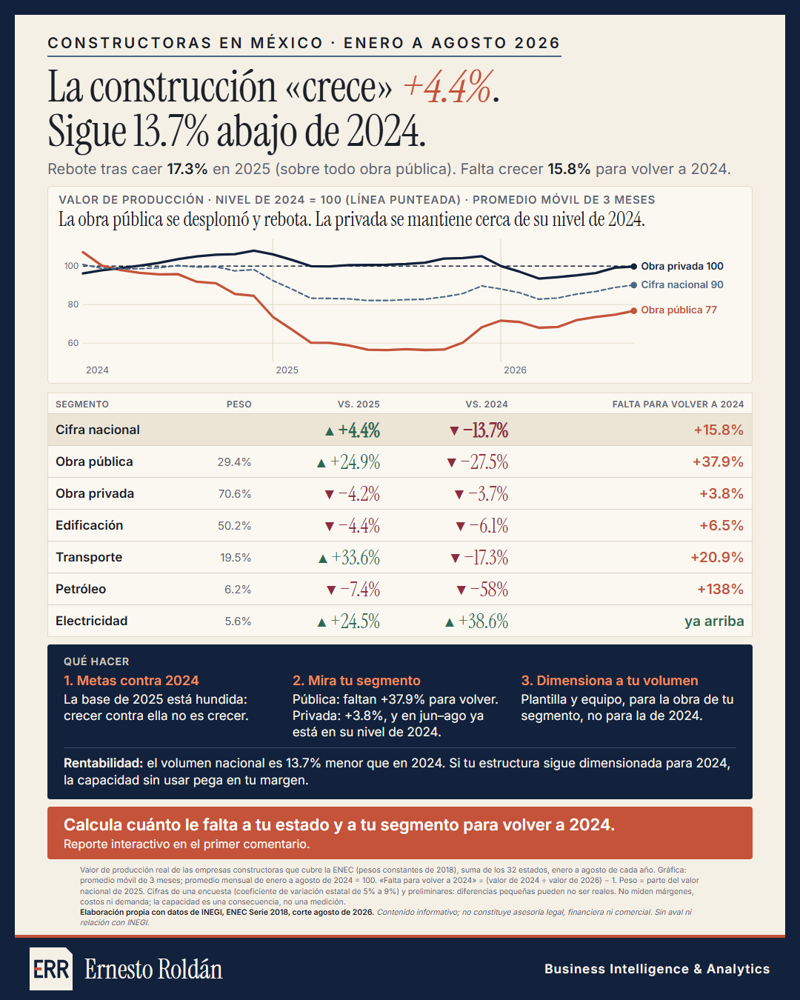

# La construcción «crece» 4.4%, pero sigue 13.7% abajo de 2024

**[Abrir el reporte interactivo](https://ernestrr.github.io/construccion-rebote-2024/)**: elige tu estado y tu segmento y mira cuánto le falta para volver a su nivel de 2024.

## Objetivo
Mostrar a dueños y directores de empresas constructoras en México si el crecimiento de 2026 que reporta la cifra nacional es crecimiento real o un rebote sobre una base baja, y qué significa para sus metas, su presupuesto y su rentabilidad.



## Pregunta
La cifra nacional de la construcción sube contra 2025. ¿Ya recuperó el nivel de 2024, y en qué segmentos?

## El hallazgo principal
**De enero a agosto de 2026, el valor de producción de las empresas constructoras sube +4.4% contra 2025, pero sigue 13.7% abajo de 2024.** En 2025 había caído 17.3%, sobre todo por la obra pública. Para volver al nivel de 2024 le falta crecer 15.8%.

- **Obra pública:** ▼ −42.0% en 2025, ▲ +24.9% en 2026 y aún 27.5% abajo de 2024. Para volver necesita crecer 37.9%.
- **Obra privada (70.6% del valor):** ▲ +0.6% en 2025 y ▼ −4.2% en 2026. Está 3.7% abajo de 2024; en junio a agosto su promedio móvil de 3 meses ya está en el nivel de 2024.
- **Edificación (50.2% del valor):** ▼ −4.4% contra 2025 y ▼ −6.1% contra 2024.
- **Transporte y urbanización:** ▲ +33.6% contra 2025, pero ▼ −17.3% contra 2024.
- **Electricidad y telecomunicaciones** es el único segmento arriba de 2024: ▲ +38.6%.

| Segmento | Peso (2025) | 2026 vs. 2025 | 2026 vs. 2024 | Falta para volver a 2024 |
|---|---:|---:|---:|---:|
| **Cifra nacional** | 100% | ▲ +4.4% | ▼ −13.7% | +15.8% |
| Obra pública | 29.4% | ▲ +24.9% | ▼ −27.5% | +37.9% |
| Obra privada | 70.6% | ▼ −4.2% | ▼ −3.7% | +3.8% |
| Edificación | 50.2% | ▼ −4.4% | ▼ −6.1% | +6.5% |
| Transporte y urbanización | 19.5% | ▲ +33.6% | ▼ −17.3% | +20.9% |
| Petróleo y petroquímica | 6.2% | ▼ −7.4% | ▼ −58.0% | +138.0% |
| Electricidad y telecomunicaciones | 5.6% | ▲ +24.5% | ▲ +38.6% | ya arriba |

La caída de 2025 se concentra en la obra pública. Estas cifras no explican por qué cayó.

## Qué significa para la rentabilidad de tu empresa
Los datos no miden márgenes, costos ni demanda. La consecuencia es de aritmética y de capacidad: el volumen nacional es 13.7% menor que en 2024, y si la plantilla y el equipo de una empresa siguen dimensionados para 2024, la capacidad sin usar pesa sobre su margen.

1. **Metas contra 2024, no contra 2025.** La base de 2025 está hundida; crecer contra ella no es recuperar.
2. **Mira tu segmento.** Calcula cuánto le falta al tuyo para volver a 2024 (tipo de obra, cliente y estado en el reporte).
3. **Dimensiona plantilla y equipo** al volumen de tu segmento.

## Complemento: la cifra nacional también esconde estados que caen
En el mismo periodo, 17 de 32 estados caen y concentran 63.1% del valor. Sin Estado de México e Hidalgo, la cifra nacional pasa de +4.4% a −3.2%. El detalle por estado y tipo de obra está en `resultados/` y en el reporte.

## Datos
- **INEGI, Encuesta Nacional de Empresas Constructoras (ENEC), Serie 2018:** valor de producción por entidad, tipo de obra y sector contratante, corte de agosto de 2026.
- **Deflactor implícito de la construcción (INEGI)** para pesos constantes de 2018. No calculé variaciones en pesos corrientes.
- Universo: 32 entidades federativas. Segmento = tipo de obra (6) o tipo de cliente (público o privado); la ENEC no publica el cruce entre ambos.

## Método
- Se compara el acumulado de enero a agosto de 2026 contra el de 2025 y el de 2024, en valor de producción real.
- «Falta para volver a 2024» = valor de 2024 ÷ valor de 2026 − 1.
- Peso = parte del valor nacional de 2025.
- La gráfica usa un promedio móvil de 3 meses con base en el promedio mensual de enero a agosto de 2024 = 100.
- Por estado, los segmentos con menos de 0.1% del valor nacional se marcan como pequeños: su variación se exagera por la base.
- `rebote.py` comprueba que la cifra nacional coincida con la de `cifras_clave.json` (+4.3575%).

## Limitaciones
- La ENEC es una muestra de empresas (coeficiente de variación estatal de 5% a 9%). Mide actividad ejecutada, no demanda capturable ni rentabilidad.
- El estado es el lugar de la obra, no el domicilio de la empresa.
- Las cifras de 2026 son preliminares y pueden revisarse; INEGI publica la siguiente el 24 de noviembre de 2026.
- Son cifras de una encuesta: diferencias pequeñas (por ejemplo, la obra privada 3.7% abajo de 2024) pueden no distinguirse del error de muestreo. No calculé intervalos de confianza.
- «Rebote» es una lectura de estos números, no una cifra publicada por INEGI.
- La gráfica (promedio de 3 meses) y la tabla (acumulado de enero a agosto) miden cortes distintos y no se mezclan en una misma comparación.

## Contenido
- [`index.html`](https://ernestrr.github.io/construccion-rebote-2024/): reporte interactivo con selector de estado y segmento y el detalle: serie mensual por segmento, aportes de 2025 y 2026 en puntos, tabla ordenable de los 32 estados, mapa de calor de estado por segmento contra 2024, y los tres cortes con su sensibilidad.
- `resultados/`: `rebote_segmentos.csv`, `rebote_estado_segmento.csv`, `serie_indice_mensual.csv`, `serie_indice_segmentos.csv`, `cifras_rebote.json`, y las tablas del análisis previo (`resultados.csv`, `titulares.csv`, `descomposicion.csv`, `sensibilidad.csv`, `series_segmentos.csv`, `cifras_clave.json`, `informe.md`, `metodologia.md`).
- `graficas/`: infografía del hallazgo.
- `src/`: `calcular.py` (análisis previo), `rebote.py` (comparación contra 2024), `construir_ejecutivo.py` (reporte), `config.json` y las fuentes tipográficas.

## Reproducir
Requiere Python con pandas y numpy.
```
python src/calcular.py              # tablas del análisis previo
python src/rebote.py                # comparación contra 2025 y 2024
python src/construir_ejecutivo.py   # index.html
```
Los scripts parten de la base procesada de la ENEC en pesos constantes (`datos/procesados/enec_vp_entidad_corr_const.csv`), que no incluyo en este repositorio; ajusta las rutas al inicio de cada script.

---
Elaboración propia con datos de INEGI (ENEC Serie 2018, corte agosto 2026). Contenido informativo; no constituye asesoría legal, financiera ni comercial. Sin aval ni relación con INEGI.

**Ernesto Roldán** · Business Intelligence & Analytics · [ernestoroldan.com](https://ernestoroldan.com)
