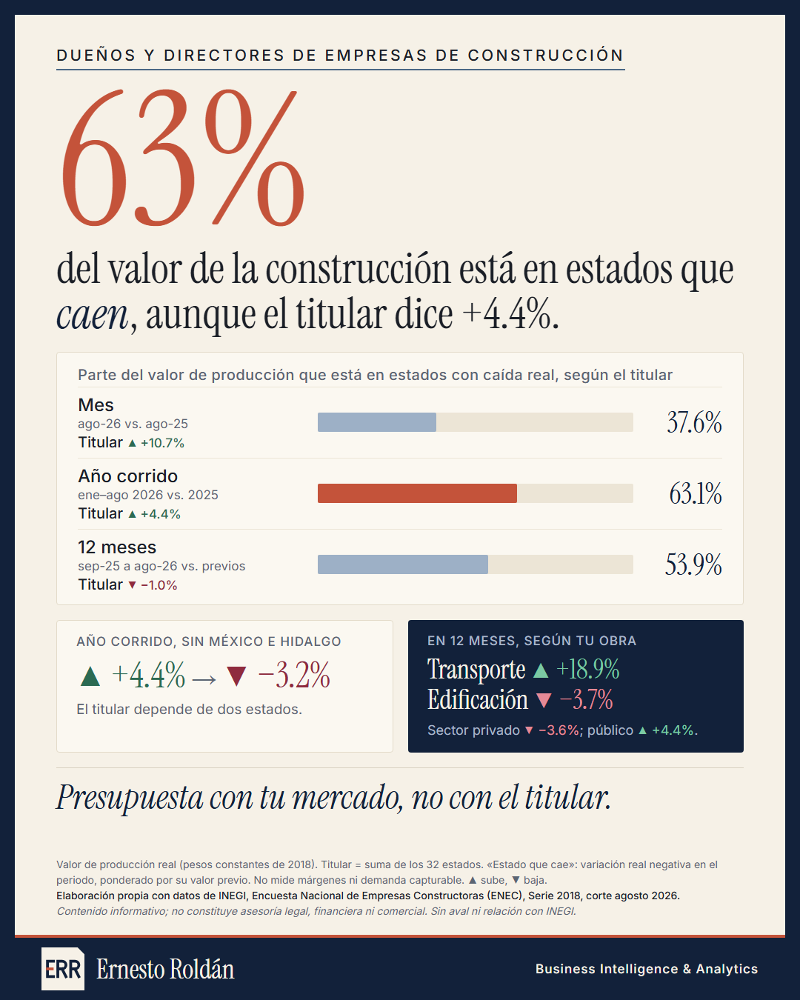
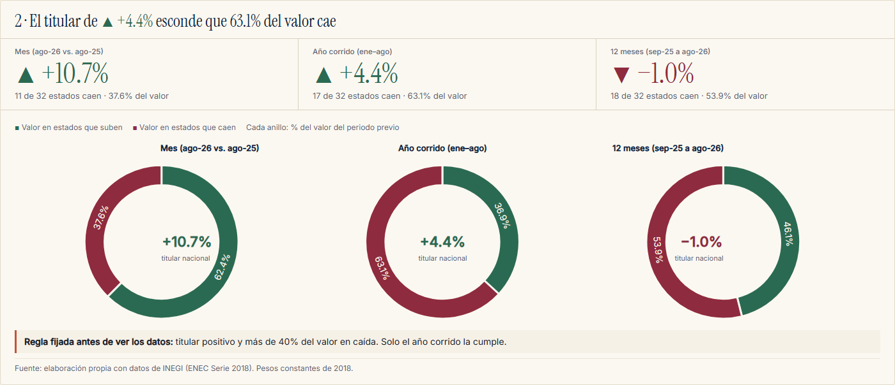
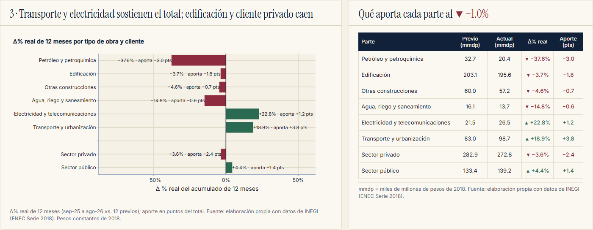

# El titular nacional no es tu mercado: construcción en México

**[Ver el tablero interactivo](https://ernestrr.github.io/construccion-titular-vs-mercado/)**

## Objetivo
Comprobar si el crecimiento nacional de la construcción que se reporta en los titulares refleja lo que pasa en el mercado de una empresa concreta (su estado, su tipo de obra y su tipo de cliente), o si lo esconde. La decisión que busco apoyar es de dirección: con qué número fijar la meta de ventas y el presupuesto de inversión del año.



## Pregunta
¿Presupuestar con el titular nacional es razonable, o hay una caída oculta en los mercados que lo componen?

## Datos
- **INEGI, Encuesta Nacional de Empresas Constructoras (ENEC), Serie 2018:** valor de producción por entidad, tipo de obra y sector contratante, corte de agosto de 2026.
- **Deflactor implícito de la construcción (INPP, INEGI)** para llevar todo a pesos constantes de 2018. No calculé variaciones en pesos corrientes.
- Universo: 32 entidades federativas. Mercado = entidad × tipo de obra (6 tipos) y entidad × sector contratante (público, privado).

## Método
Fijé los criterios antes de ver los resultados (están en `src/config.json`):
- **Medida:** valor de producción real, acumulado de 12 meses contra los 12 meses previos. También comparo tres titulares: el del mes, el del año corrido y el de 12 meses.
- **Mercado relevante:** celda cuyo acumulado previo sea al menos 0.1% del total nacional. Las demás se muestran, pero no entran en los conteos.
- **Caída oculta:** el titular es positivo y más de 40% del valor previo está en mercados que caen, o la mediana ponderada de los mercados es negativa.
- **Ponderación:** el peso es el valor del periodo previo; no promedio tasas estatales sin ponderar.
- **Aporte:** cambio del monto real de cada parte entre el acumulado previo nacional, en puntos porcentuales (suman el total).
- **Sensibilidad:** cambio de titular, sin México e Hidalgo, sin petróleo y petroquímica, y umbrales de relevancia de 0.05% y 0.25%.

## Hallazgos
1. **Depende del titular.** El año corrido (ene–ago 2026) es **+4.4%**, pero 17 de 32 estados, con **63.1% del valor**, caen: es el único que cumple la regla de caída oculta. El del mes (+10.7%) es más amplio y el de 12 meses es −1.0%.
2. **El total junta partes distintas** (12 meses): transporte y urbanización +18.9% y electricidad y telecomunicaciones +22.8% compensan edificación −3.7%, petróleo y petroquímica −37.6% y agua −14.8%.
3. **Por cliente:** el sector privado cae 3.6% y el público sube 4.4%.
4. **Del agregado al detalle:** 73 de 125 mercados (estado × tipo de obra) caen. Concentran 61.8% del valor y su mediana ponderada es −6.4%. Con otros umbrales, entre 59% y 62% del valor cae.
5. **El titular depende de dos estados:** sin México e Hidalgo, el año corrido pasa de +4.4% a −3.2%.

### Tres titulares, tres lecturas


### Qué parte sostiene y cuál resta (12 meses)


## Implicación para la gestión
Un titular nacional es un promedio de mercados muy distintos. Presupuestar con él puede sobreestimar ventas si el mercado propio es edificación o clientes privados. La recomendación es definir el mercado propio y comparar cada mes su variación real contra el titular. Regla propuesta, a validar con datos de cada empresa: si la brecha es menor a −5 puntos durante tres cortes seguidos, revisar el plan comercial.

## Limitaciones
- La ENEC es una muestra de empresas (coeficiente de variación estatal de 5% a 9%). Mide actividad ejecutada, no demanda capturable ni rentabilidad.
- El estado es el lugar de la obra, no el domicilio de la empresa.
- Un mercado que cae en los datos no implica que una empresa concreta pierda ventas.
- Las cifras de 2026 son preliminares y pueden revisarse.
- Los tres titulares miden periodos distintos y no se mezclan en una misma comparación. No estimé ningún modelo.
- Faltaría información de cada empresa: cartera propia, márgenes y plazos de cobro.

## Contenido
- [`index.html`](https://ernestrr.github.io/construccion-titular-vs-mercado/): tablero interactivo (selector de estado y de tipo de obra o cliente).
- `resultados/`: tablas (`resultados.csv`, `titulares.csv`, `descomposicion.csv`, `sensibilidad.csv`, `series_segmentos.csv`), `cifras_clave.json`, `informe.md` y `metodologia.md`.
- `graficas/`: imágenes del resumen y de los hallazgos.
- `src/`: `calcular.py` (cifras), `construir_entregables.py` (tablero), `plantilla.html`, `config.json` y las fuentes tipográficas.

## Reproducir
Requiere Python con pandas, numpy y plotly.
```
python src/calcular.py                 # tablas y cifras_clave.json
python src/construir_entregables.py    # index.html
```
Los scripts parten de la base procesada de la ENEC en pesos constantes (`datos/procesados/enec_vp_entidad_corr_const.csv`), que no incluyo en este repositorio; ajusta las rutas al inicio de cada script.

---
Elaboración propia con datos de INEGI (ENEC Serie 2018, corte agosto 2026). Contenido informativo; no constituye asesoría legal, financiera ni comercial. Sin aval ni relación con INEGI.

**Ernesto Roldán** · Business Intelligence & Analytics · [ernestoroldan.com](https://ernestoroldan.com)
